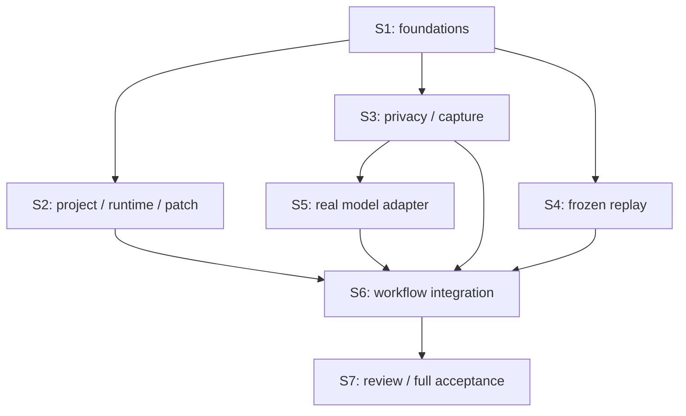

# Parallel PR Slice Dispatch: Spec 006

**Status**: Scheduling correction requested by the owner on 2026-11-04. The owner then authorized local
S1 only; S1 (T001–T009) is implemented locally and unpublished ([verification.md](verification.md)). No
S2–S7 task has run.
**Supersedes**: The single delivery I6/T001–T055 and shared-checkout four-lane schedule in `3783a8a`.
**Delivery**: Seven PR-sized slices from [tasks.md](tasks.md#delivery-slices), not one 55-task PR.
**Feature acceptance**: Real project -> direct demonstration -> actual image/code AI analysis -> derived
reproduction -> intended baseline failure -> one real correction -> independent verification -> retained
review. This full-feature gate remains mandatory in S7; intermediate infrastructure/module PRs do not
claim the product is complete. No model work is postponed to a new feature or optional future release.

## PR Graph and Worktrees

- Finish/validate S1 first. Once its PR merges, update main and start **S2/S3/S4 concurrently** from
  that merged foundation in three isolated branches/worktrees. At most four agents are active: the
  parent coordinator plus these three implementation owners, not four workers plus a parent.
- Once S3 merges, S5 can start from updated main using the released worker slot while S2/S4 continue.
  S5 imports the merged privacy contract; no unpublished cross-worktree dependency is allowed.
- S6 starts only after S2/S3/S4/S5 merge. S7 follows merged S6. Every later branch starts from current
  main after prerequisite merges; no implicit stacked PRs, cherry-picking unpublished modules or
  feature integration branch. S6/S7 contain their own deltas, not all previous implementation again.
- Each slice has one implementation owner and its own commits, focused checks and PR review. The
  coordinator reviews dependencies and evidence. Validate/report/stop at each authorized slice boundary
  according to `CONTRIBUTING.md`. This schedule is not authorization to implement, push, open PRs or merge.

| Slice | Planned branch | Exact tasks | Main verification question |
| --- | --- | --- | --- |
| S1 | `feat/006-project-live-verification` (existing first branch) | T001–T009 | Are identity, state, outside-root storage and immutable runtime prerequisites trustworthy? |
| S2 | `feat/006-project-live-verification-runtime` | T010–T020, T035, T039 | Can a real project run offline and receive a guarded patch only in an owned copy? |
| S3 | `feat/006-project-live-verification-capture` | T021–T022, T024–T025 | Can the recorder produce a sealed, ordered, pre-retention-safe report? |
| S4 | `feat/006-project-live-verification-replay` | T034, T037 | Can a strict host-owned definition replay/check without generated executable code? |
| S5 | `feat/006-project-live-verification-model` | T023, T027–T028, T031 | Does the actual adapter construct real-image requests and enforce model/schema/call boundaries? |
| S6 | `feat/006-project-live-verification-workflow` | T026, T029–T030, T032–T033, T036, T038, T040–T043 | Does the integrated state machine require intended baseline failure and identical candidate checks? |
| S7 | `feat/006-project-live-verification-review` | T044–T055 | Can the user inspect retained evidence/diff and does the actual live full flow meet every gate? |

Task IDs are stable even when a coherent PR combines noncontiguous tasks. All 55 IDs have one owning
slice. Story phases organize requirements; PR boundaries organize review and integration. The first
usable full feature is accepted only at S7/I6, not at an onboarding/module checkpoint.

## File Ownership Between Sibling PRs

Paths below are relative to `packages/flowproof/src/` unless they name a repository-root directory.
A slice owns the test files named by its exact tasks. Later slices modify these only after their
predecessor PR merges, in a new branch; this is not shared-checkout handoff.

| Slice | Owned implementation surfaces | Important boundary |
| --- | --- | --- |
| S1 | `project/contracts.ts`, initial `project/run.ts`, `evidence/projectStore.ts`; `tools/runtime/project-vite.Dockerfile`, `tools/runtime/prepare-project-vite.mjs`; sample fixtures/helper; `package.json`, `vitest.config.ts` | Publish tested shared types, identities, cancellation and artifact interfaces before sibling PRs start. |
| S2 | `project/{admission,snapshot,profile,runtime}.ts`, `patch/projectDiff.ts`, `cli.ts`, `studio/{targetApp,launch,server}.ts`; `apps/studio/src/api.ts`, `apps/studio/src/state.ts`, `apps/studio/src/App.tsx`, `apps/studio/src/components/ProjectSetup.tsx` | No capture/model/replay module edits. T019 owns only project setup wiring at this stage. |
| S3 | `capture/projectPrivacy.ts`, `capture/projectRecorder.ts`; capture contract/privacy tests and synthetic-frame seeded-mask E2E | No Studio/server/orchestrator changes. Production target integration and navigation races T026 are in S6. |
| S4 | `verify/projectReplay.ts`, `tests/unit/project-replay.test.ts` | No runtime/orchestrator/Studio changes. Later T038/T040 changes belong to S6 after S4 merges. |
| S5 | `model/projectPrompt.ts`, `model/projectClient.ts`; model contracts and isolated smoke test | Depends on merged S3 privacy interfaces, not a copied stub. No default test may call the provider. |
| S6 | `project/run.ts`, integrated `verify/projectReplay.ts`, Studio server, capture/analysis/verification API/state/UI, manual live harness and integration E2E tests | Earlier modules already merged; one owner integrates authority boundaries and existing-mode separation. |
| S7 | Retained result/artifact routes/store, result/evidence/diff UI, final negatives/docs/verification and task marks | Do not regenerate model output to populate review; validate actual available artifacts and final evidence. |

Within sibling S2/S3/S4, source and test surfaces are disjoint. Their only common inputs are the
merged S1 contracts. If that contract is wrong, coordinate a focused prerequisite fix instead of
creating three incompatible private schemas. Capture masking and replay can be tested on explicitly
synthetic target frames independently of S2; those tests are not real-project integration acceptance.

## Exact Task Predecessors

The matrix refines module readiness, while the PR graph adds merge prerequisites. Both must hold:
a task may not bypass a required merged predecessor slice just because its own unit inputs are ready.
`—` means no task predecessor, not permission to skip design reads or implementation authorization.
Tests written before implementation require meaningful failure/pass evidence before completion marks.

| Task | Owning slice | Required predecessors |
| --- | --- | --- |
| T001 | S1 | — |
| T002 | S1 | T001 |
| T003 | S1 | — |
| T004 | S1 | — |
| T005 | S1 | T004 |
| T006 | S1 | — |
| T007 | S1 | T005, T006 |
| T008 | S1 | — |
| T009 | S1 | T005, T008 |
| T010 | S2 | T005, T007, T009 |
| T011 | S2 | T005, T007, T009 |
| T012 | S2 | T005, T007, T009 |
| T013 | S2 | T005, T007, T009 |
| T014 | S2 | T010 |
| T015 | S2 | T014 |
| T016 | S2 | T002, T005, T010 |
| T017 | S2 | T011, T015, T016 |
| T018 | S2 | T012, T017 |
| T019 | S2 | T013, T014, T015, T016, T017, T018 |
| T020 | S2 | T019 |
| T021 | S3 | T005, T007, T009 |
| T022 | S3 | T005, T007, T009 |
| T023 | S5 | T005, T007, T009 |
| T024 | S3 | T022 |
| T025 | S3 | T021, T024 |
| T026 | S6 | T018, T025 |
| T027 | S5 | T023, T024 |
| T028 | S5 | T023, T027 |
| T029 | S6 | T019, T025, T028 |
| T030 | S6 | T029 |
| T031 | S5 | T003, T028 |
| T032 | S6 | T029, T030 |
| T033 | S6 | T026, T027, T028, T029, T030, T031, T032 |
| T034 | S4 | T005, T007, T009 |
| T035 | S2 | T005, T007, T009 |
| T036 | S6 | T005, T007, T009 |
| T037 | S4 | T034 |
| T038 | S6 | T036, T037, T017, T018, T029 |
| T039 | S2 | T035, T015 |
| T040 | S6 | T038, T039 |
| T041 | S6 | T028, T038, T040 |
| T042 | S6 | T030, T041 |
| T043 | S6 | T033, T042 |
| T044 | S7 | T005, T007, T009 |
| T045 | S7 | T044, T041, T042 |
| T046 | S7 | T007, T039, T044 |
| T047 | S7 | T045, T046 |
| T048 | S7 | T047 |
| T049 | S7 | T047 |
| T050 | S7 | T020, T026, T032, T033, T043, T048, T049 |
| T051 | S7 | T048, T049 |
| T052 | S7 | T050, T051 |
| T053 | S7 | T031, T043, T052 |
| T054 | S7 | T048, T052 |
| T055 | S7 | T052, T053, T054 |

T031 authors the opt-in provider test; it does not call the provider during S5 completion. Actual image
protocol and full-live calls remain T053 in S7 after T052 final regression. Untimed owner T054 may share
that live session; absent feedback remains open. Slice merges never stand in for full-feature acceptance.

## Focused Slice Verification

Commands below are planned for implementation, not checks already executed. Each PR runs its own
`pnpm typecheck`, `pnpm build`, `git diff --check`, exact focused tests and relevant existing regression.
Resource-heavy commands use the lease below. Default discovery must continue excluding live tests.

| Slice | Focused commands / evidence, in addition to the common PR checks |
| --- | --- |
| S1 | `pnpm exec vitest run tests/contract/project-contracts.test.ts tests/unit/project-store.test.ts tests/unit/project-lifecycle.test.ts --fileParallelism=false`; inspect the actual immutable image/dependency manifest; prove default discovery excludes live smoke. |
| S2 | `pnpm exec vitest run tests/unit/project-admission.test.ts tests/integration/project-runtime.test.ts tests/integration/project-target-security.test.ts tests/contract/project-studio.test.ts tests/unit/project-patch.test.ts --fileParallelism=false`; `pnpm exec playwright test tests/e2e/project-setup.spec.ts`; real original-integrity/container-cleanup evidence. |
| S3 | `pnpm exec vitest run tests/contract/project-capture.test.ts tests/unit/project-privacy.test.ts --fileParallelism=false`; `pnpm exec playwright test tests/e2e/project-privacy.spec.ts` using controlled synthetic target frames for seeded-pixel checks; no claim of S2 integration. |
| S4 | `pnpm exec vitest run tests/unit/project-replay.test.ts --fileParallelism=false`; verify closed DSL, frozen identities, unique locators, semantic bounds and unsupported operations. |
| S5 | `pnpm exec vitest run tests/contract/project-model.test.ts --fileParallelism=false`; inspect explicit `project-meta-smoke` registration and default exclusion; label in-process fakes, no live/model-result claim. |
| S6 | `pnpm exec vitest run tests/integration/project-analysis.test.ts tests/integration/project-correction.test.ts tests/integration/project-verification.test.ts --fileParallelism=false`; `pnpm exec playwright test tests/e2e/project-recording.spec.ts tests/e2e/project-analysis.spec.ts tests/e2e/project-verification.spec.ts`; prepare non-default live harness, do not execute it yet. |
| S7 | Focused result/artifact/safety/UI and existing prepared-mode checks, then full V1/V2/V3 from tasks.md, with actual final HEAD/model/capture/candidate/evidence/integrity/cleanup and untimed owner feedback. |

## Resources, Git and Evidence

- Each worker uses only its assigned branch/worktree and named slice's paths. It may commit coherent,
  locally verified units there; no worker stages another worktree's files, resets peer work, updates
  other slice marks or publishes without authorization. Update only its supported completion marks;
  reconcile the shared task ledger against latest main before publication to avoid lost checkbox edits.
- Separate worktrees isolate source and build output. The coordinator still issues one exclusive lease
  for image preparation, Docker-backed checks, headed-browser suites, full builds/suites and live calls.
  Include owned ports/containers/output roots and cleanup evidence. Resource-free checks may overlap.
- Validate each slice on its actual branch HEAD. If main or a prerequisite changes, update/rebase as
  appropriate and rerun affected checks before review/merge. Existing review and merge authorization
  rules in `CONTRIBUTING.md` remain unchanged; no PR is implicitly merged by finishing its worker.
- S7 final checks and actual live acceptance bind to one final implementation HEAD. Later source
  changes invalidate affected evidence. A missing image, unavailable actual provider or missing owner
  feedback is reported as a dependency, not skipped into success.

## Slice Dispatch Template

> Execute only slice `<S1..S7>` and its exact IDs from the delivery ledger after implementation is
> authorized. Use its own branch/worktree from main after prerequisite PRs merge. Read repository and
> feature instructions; respect merged contracts, owned paths and the resource lease. Return changed
> files/commits, exact HEAD, actual verification, cleanup and gaps, then stop at this slice boundary.
> No next slice, publication, merge, deployment or premature actual-provider call is implied.

This scheduling review is not a formal `speckit-analyze` result. Resolve any critical/high/Constitution
findings from that recommended consistency stage before implementation.
