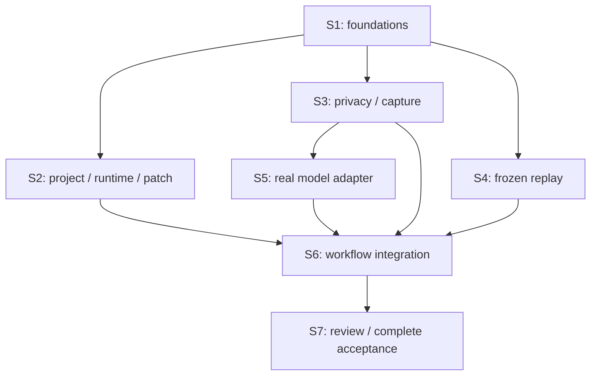

# Tasks: User Project Onboarding and Live AI Fix Verification

**Input**: [spec.md](spec.md), [plan.md](plan.md), [research.md](research.md),
[data-model.md](data-model.md), [contracts](contracts/cli-and-studio.md) and [quickstart.md](quickstart.md).

**Branch**: `feat/006-project-live-verification` | **Created**: 2026-11-04

**Authorization**: The owner authorized implementation, publication, review-loop corrections and
conditional merge of all remaining S2–S7 slices on 2026-11-04 (message 25501), using Opus with parent
independent verification. S1 and S4 have merged through PRs #27 and #29. Each later slice still follows
its predecessor merges and its own verification/PR gates. Checked tasks describe implemented work
present in this branch; unchecked sibling tasks do not revoke the authorization or describe another
worktree's status. Actual provider acceptance remains T053 after final regression; T054 requires real
owner feedback and is never self-approved. Deployment remains canceled and outside scope.

**Tests**: Required acceptance coverage comes from the Spec's independent tests/SC-001–SC-010 and the
Plan's explicit risk-based verification/TDD strategy. Write focused parser/authority/path/privacy/race
tests before their implementation and verify meaningful failures. Do not add implementation-mirroring
or cosmetic tests. In-process model fakes are labelled and never substitute for real-model acceptance.

**Organization**: Setup, blocking foundations, one phase per prioritized user story, then cross-cutting
acceptance. Task IDs are sequential; `[P]` marks independent file work that may overlap after its stated
prerequisites, not permission to run port/resource-heavy tests concurrently. Source paths below are
planned files, not a claim they exist. Reuse existing modules without weakening old contracts.

**Parallel dispatch**: [parallel-execution.md](parallel-execution.md) assigns every task exactly once
to seven PR-sized slices, records exact predecessor IDs, separate worktrees and resource ownership.
Story phases describe integration order, not a blanket barrier on independent module work.

## Phase 1: Setup (Shared Infrastructure)

**Purpose**: Prepare deterministic permitted project inputs, the offline dependency profile and an
explicit live-test boundary. These are internal prerequisites, not a delivered user-project feature.

- [X] T001 [P] Create a permitted deterministic DOM-bug sample under `tests/fixtures/project-live/` and `tests/helpers/projectLiveRepository.ts` that materializes a clean independent Git repository outside FlowProof, with committed React/Vite source, lockfile and a project check; keep expected fixes out of production admission/model selection and record original tracked/untracked/ignored/index/ref snapshots.
- [X] T002 Build the operator-only offline toolchain preparation in `tools/runtime/project-vite.Dockerfile` and `tools/runtime/prepare-project-vite.mjs`, using T001's locked dependency set; record the actual inspected immutable image/dependency digests and required tool paths without fabricating hashes or installing/pulling during the selected-project flow. No provider credential enters the image.
- [X] T003 [P] Update `vitest.config.ts` and `package.json` to exclude `tests/integration/project-live-meta-smoke.test.ts` from every default project and expose an explicit `project-meta-smoke` project; prove default discovery cannot invoke it. Keep a later manual full-live runner outside default Vitest/Playwright discovery.

**Checkpoint I1a**: Sample and real operator image/dependency manifest are prepared; missing runtime
resources are a blocker, not an excuse to use host builds or a mutable tag. No model call is needed.

## Phase 2: Foundational (Blocking Prerequisites)

**Purpose**: Establish strict data/authority boundaries, outside-checkout artifacts and a fail-closed
lifecycle before user-story orchestration. No user story bypasses these foundations.

- [X] T004 [P] Write `tests/contract/project-contracts.test.ts` for closed project-live objects, host-generated UUIDs/SHA-256 identities and every entity/status/limit in `data-model.md`; reject extra keys, client filesystem authority, malformed/boundary values and wrong run/capture/baseline identity before side effects.
- [X] T005 Implement shared entity contracts in `packages/flowproof/src/project/contracts.ts`: ProjectContext/ExecutionConfiguration, DemonstrationCapture/InteractionObservation/SafeObservation, Interpretation/FrozenVerificationDefinition, ProviderInvocation/Candidate/ProjectRunResult. Preserve the exact enums and constraints in the Constraint Register below; legacy diagnosis/gate/result schemas retain their meanings. Depends on T004.
- [X] T006 [P] Write `tests/unit/project-store.test.ts` for an owner-only state root outside the selected checkout, no-follow path/digest/registered-ID reads, original zero-write behavior, private permissions, discarded-report removal and rejection of a state/temp root inside the selected repository.
- [X] T007 Implement `packages/flowproof/src/evidence/projectStore.ts` using T005/T006: sanitized staging, closed per-run registration and exact-byte hash verification, 0700 directories/0600 files where supported, outside-checkout persistence and safe partial-result retention. Never create `.flowproof` or change `.gitignore` in the selected repository.
- [X] T008 [P] Write `tests/unit/project-lifecycle.test.ts` for sticky cancellation, idempotent ownership cleanup, late model/build completion, cleanup/integrity overriding provisional pass, and automatic timers excluding demonstration/clarification/interpretation/result human waiting states.
- [X] T009 Add the typed lifecycle/ownership skeleton in `packages/flowproof/src/project/run.ts` and shared state helpers in `packages/flowproof/src/project/contracts.ts` after T005/T008; implement the declared run-state sequence and check statuses, with no authority to pass before all obligations/finalization. Phase-specific operations are connected in US1–US3, not replaced with fixture shortcuts.

**Checkpoint I1b**: Foundation tests pass; it remains impossible to request a fake project success or
write artifacts into the original. These are internal commit milestones, not an onboarding-only release.

## Phase 3: User Story 1 — Open My Project and Confirm What Will Run (Priority: P1)

**Goal**: Launch for a real local project, confirm its identity/settings, then show its actual isolated
running application. No project code executes merely from selection and no model request occurs.

**Independent Test**: On the separate T001 repository, identify root/branch/revision/configuration,
prepare the target, and interact with it. Reject invalid, dirty, stale, unsupported or missing-resource
cases before model calls; original state is unchanged (FR-001–FR-003, SC-002/SC-003).

### Tests First

- [ ] T010 [P] [US1] Write `tests/unit/project-admission.test.ts` for canonical nested paths, exact committed root/revision, protected inputs, clean tracked state, missing/untracked source prerequisites, symlinks/gitlinks, secrets, unsupported layouts and lock/config changes; include rejection before commands or model calls and no silent baseline refresh.
- [ ] T011 [P] [US1] Write `tests/integration/project-runtime.test.ts` for immutable image/lock admission, direct-argv-only offline execution, explicit environment/private HOME, no original/history/key mounts, source/check immutability, bounded output and stop/join-before-copy/serve behavior. Do not treat the existing bridge editor as this runtime.
- [ ] T012 [P] [US1] Write `tests/integration/project-target-security.test.ts` for actual built target identity/readiness, source/output path confinement, target CSP/sandbox and exact-origin browser policy; deny target access to Studio, external/private/other-loopback hosts, WebSockets, service workers, popups, downloads and cross-origin navigation.
- [ ] T013 [P] [US1] Write `tests/contract/project-studio.test.ts` for CLI exclusivity and project context/configuration/prepare routes, strict bodies and exact Host/Origin/cookie/session guards; missing config is reviewable data, not permission to run scripts or change host/model/network policy.

### Implementation

- [ ] T014 [US1] Implement canonical read-only admission and stale checks in `packages/flowproof/src/project/admission.ts` after T010: inspect committed inputs with hooks/filters/fsmonitor/global Git overrides disabled, pin identity and safe manifests, reject unsupported data without original writes, and never copy ignored original dependencies.
- [ ] T015 [US1] Implement `packages/flowproof/src/project/snapshot.ts` after T014: export only admitted committed regular files into owned snapshots, with trusted private Git/frozen metadata outside runtime mounts; exclude `.git`, history, credentials, untracked content and original `node_modules`, and preserve exact source/config tree hashes.
- [ ] T016 [US1] Implement `packages/flowproof/src/project/profile.ts` from T002/T005/T010: fixed `vite-static-v1`/matching lock-dependency digest, confirmed relative entry/build/output/required-check data, no shell/policy/credential overrides, and the exact execution limits in the Constraint Register. Settings changes invalidate prepared/capture state.
- [ ] T017 [US1] Implement `packages/flowproof/src/project/runtime.ts` after T011/T015/T016: non-root/read-only-root/drop-capabilities/no-new-privileges/offline containers, owned workspace/output/cache, read-only prepared dependencies and confined direct argv; check source/config/check hashes, stop/join producers, then copy only bounded no-follow regular output to immutable host serving storage.
- [ ] T018 [US1] Add project target ownership/readiness in `packages/flowproof/src/studio/targetApp.ts` and the project branch of `packages/flowproof/src/studio/launch.ts` after T012/T017; serve actual isolated static output at the admitted localhost origin, install target-specific browser/CSP/sandbox controls, and do not rely on the old chart-global probe or run a repository dev server on the host.
- [ ] T019 [US1] Wire additive `--project`/`--project-config`, strict context/configuration/prepare routes and setup UI in `packages/flowproof/src/cli.ts`, `packages/flowproof/src/studio/server.ts`, `apps/studio/src/api.ts`, `apps/studio/src/state.ts`, `apps/studio/src/App.tsx`, and `apps/studio/src/components/ProjectSetup.tsx` after T013–T018; display real root/branch/revision/category/model-configured state and require command confirmation without adding folder browser/model picker/automatic install.
- [ ] T020 [US1] Verify the independent project-setup journey in `tests/e2e/project-setup.spec.ts` after T019, including actual interactive target, unchanged original, no call on selection/preparation, blocked/stale settings and existing-mode CLI compatibility; preserve observed output/cleanup identities under the ignored review root.

**Checkpoint I2**: US1 is independently testable without a model. Do not deliver it as the Spec 006
MVP: direct capture, real AI and independent correction verification are still required for final feature acceptance in S7.

## Phase 4: User Story 2 — Ask a Real AI to Correct My Reproducible Problem (Priority: P1)

**Goal**: The developer demonstrates the defect, AI analyzes real safe observations/code and derives
its replay/check; after a proved baseline failure the correction adapter can produce one actual patch.
The latter transition is integrated by US3, avoiding a circular story dependency.

**Independent Test**: Capture a supported demonstration without a handwritten step list/test, inspect
analysis/clarification and a candidate response through the real adapter when execution is authorized.
Adapter tests may supply a previously verified baseline boundary explicitly; full acceptance uses the
US3 baseline gate, never a caller-controlled browser boolean (FR-004/FR-006/FR-007/FR-018/FR-019).

### Tests First

- [X] T021 [P] [US2] Write `tests/contract/project-capture.test.ts` for target/frame/epoch/sequence binding, `idle -> recording -> finishing -> ready`, pre-analysis `recording|finishing|ready -> discarded`, complete/incomplete/unsupported states, caps and stable Finish digests; capture alone must not call a model.
- [X] T022 [P] [US2] Write `tests/unit/project-privacy.test.ts` for excluded input/locator/source/URL/error content, target-only screenshots and pre-persistence masks, safe synthetic values and unknown-sensitive-surface rejection. Add pixel-level seeded rendered-secret coverage to `tests/e2e/project-privacy.spec.ts`; PNG marker-byte scans alone do not prove masking.
- [ ] T023 [P] [US2] Write `tests/contract/project-model.test.ts` for real image block construction, closed `ready|clarify|unsupported` analysis and correction schemas, evidence references, actual requested/observed model+response ID, auth/error redaction, request/call budgets and explicit clarification re-analysis. Test no fixture/provider/text-only-image fallback and no automatic retries/tools.

### Implementation

- [X] T024 [US2] Implement `packages/flowproof/src/capture/projectPrivacy.ts` after T022: sanitize before staging/hashing/persistence, mask input/contenteditable/private regions while producing the target PNG, admit safe synthetic fill values separately, mark missing necessary values/unknown sensitive visual surfaces unsupported, and never collect Studio/desktop/raw trace/HAR/video/headers/bodies/cookies.
- [X] T025 [US2] Implement `packages/flowproof/src/capture/projectRecorder.ts` after T021/T024: attach only to the actual target frame, validate source/epoch and host-assign sequence, record click/fill/native-select/coalesced-scroll/same-origin navigation plus associated safe images/errors; flush on navigation/Finish, make gaps/unsupported actions/caps explicit and support discard/re-record without human deadlines.
- [ ] T026 [US2] Validate recorder navigation/input/scroll ordering and Finish/Discard/cancel races in `tests/e2e/project-recording.spec.ts` after T025; assert no unrelated frame data, no model request before Analyze, no report reuse after discard and no silent complete status after overflow or unsupported actions.
- [ ] T027 [US2] Implement `packages/flowproof/src/model/projectPrompt.ts` after T023/T024: admitted code/actions/errors plus actual safe PNG image content, deterministic disclosed image/source selection, existing evidence citations and the exact 32-file/256-KiB/eight-image/8-MiB request bounds; reject essential omissions rather than silently truncate context.
- [ ] T028 [US2] Implement `packages/flowproof/src/model/projectClient.ts` after T023/T027: existing host-only Meta endpoint/`muse-spark-1.3`/`MODEL_API_KEY`, stateless `store:false`, strict phase output, no retries/tools/redirects or implicit environment overrides, sticky cancellation, safe invocation records and response identity validation. Keep legacy `diagnose()` and one-file output unchanged.
- [ ] T029 [US2] Connect capture start/finish/discard/analyze/clarify ownership in `packages/flowproof/src/project/run.ts` and `packages/flowproof/src/studio/server.ts` after T025/T028: sealed-report submission only on explicit Analyze, one active attempt, at most one user-triggered re-analysis, sticky cancel after data may already have been sent, and no correction before the later host-owned baseline gate.
- [ ] T030 [US2] Implement capture/report/interpretation/clarification UI in `apps/studio/src/components/DemonstrationPanel.tsx` and `apps/studio/src/api.ts`, `apps/studio/src/state.ts`, `apps/studio/src/presentation.ts`, integrating through `apps/studio/src/App.tsx` after T029; preserve input/focus/read position, show data-transfer scope/availability, and never require a typed reproduction script/assertion or invent hidden reasoning/progress.
- [ ] T031 [US2] Implement the isolated synthetic image+strict-schema gate in `tests/integration/project-live-meta-smoke.test.ts` after T003/T028, asserting safe actual image interpretation and requested/observed model/response ID when explicitly run at final live acceptance. A missing key/quota/image/schema result remains a blocker, not a fixture pass.
- [ ] T032 [US2] Add interpretation/clarification and provider-failure integration coverage in `tests/integration/project-analysis.test.ts` after T029/T030: wrong citations, missing facts/intent, exhausted single clarification, redacted replay value, stale answer, invalid model identity, missing key and late completion cannot become a usable silently invented report or patch.
- [ ] T033 [US2] Verify capture-to-interpretation and the isolated correction-adapter boundary in `tests/e2e/project-analysis.spec.ts` and `tests/integration/project-correction.test.ts` after T026–T032; ordinary deterministic runs use explicitly labelled in-process fakes, while the real adapter/protocol gate remains separate. No fixture result is counted as SC-001 or evidence that the full loop works.

**Checkpoint I3**: User demonstration and analysis are independently inspectable. The correction
adapter is implemented but is not unlocked by browser-supplied proof. Do not call this the delivered
MVP until US3 connects the baseline gate and a real end-to-end run passes.

## Phase 5: User Story 3 — Verify the Same Problem Before and After the Change (Priority: P1)

**Goal**: Freeze the model-derived obligation outside editable storage, prove the intended baseline
failure, request one actual correction, then independently evaluate the same obligation and project
checks on the exact candidate. A model diagnosis, screenshot difference or missing check never passes.

**Independent Test**: Evaluate fixed permitted baseline/candidate pairs with the frozen definition:
true correction, ineffective change, broken check/build, modified definition, missing/wrong-run evidence,
non-reproduction and cancellation. This isolates evaluator correctness without another model call;
the first delivery also requires the real integrated run (FR-005/FR-008–FR-011/SC-001/SC-004).

### Tests First

- [X] T034 [P] [US3] Write `tests/unit/project-replay.test.ts` for the closed click/fill/select/scroll/navigate/wait interpreter, unique safe locators, 1–8 conjunctive conditions, semantic/byte bounds, frozen definition and fresh state; reject model JavaScript/evaluate/shell/unknown operations, false placeholder expectations and external navigation before execution.
- [ ] T035 [P] [US3] Write `tests/unit/project-patch.test.ts` for `proposed|rejected|applied-to-copy`, exact baseline/evidence, “Up to eight existing admitted regular source text files and 64 KiB patch,” and every protected/path/binary/mode/new/delete/rename/link rejection; prove zero original/Git-object writes on valid and invalid application.
- [ ] T036 [P] [US3] Write `tests/integration/project-verification.test.ts` for intended baseline-condition fail versus startup/locator/timeout/unrelated failures, candidate build/check/replay, mutated source/definition, missing collectors/evidence, sticky cancel and integrity/cleanup precedence; “no missing check is a pass.”

### Implementation

- [X] T037 [US3] Implement the host-only DSL compiler and frozen definition in `packages/flowproof/src/verify/projectReplay.ts` after T034: bind project/baseline/configuration/report/interpretation/source/check/evidence/compiler digests, resolve ambiguity before freezing and keep evaluator/definitions outside candidate mounts; no user-authored executable representation is required.
- [ ] T038 [US3] Implement independent fresh-state baseline replay in `packages/flowproof/src/project/run.ts` and `packages/flowproof/src/verify/projectReplay.ts` after T036/T037/T017/T018: every action must execute and the designated expected condition must fail in the intended way with required evidence before correction. Already-passing, unsupported or operationally failed baselines stop explicitly.
- [ ] T039 [US3] Implement `packages/flowproof/src/patch/projectDiff.ts` after T035/T015: strict multi-file UTF-8 diff/citation/path guards, private-index exact-baseline application once in a new owned copy, secret/protected-input checks and exact candidate/tree/diff hashes; no legacy guard weakening, partial apply, 3-way repair or original metadata writes.
- [ ] T040 [US3] Implement candidate build/project-check/replay verification in `packages/flowproof/src/project/run.ts` and `packages/flowproof/src/verify/projectReplay.ts` after T038/T039: source/config/check identity before and after offline execution, producer stop/join before immutable output acceptance, fresh browser state, identical frozen conditions and build/run-bound observations; candidate pass text has no authority.
- [ ] T041 [US3] Complete orchestration and terminal reduction in `packages/flowproof/src/project/run.ts` after T028/T038/T040: freeze -> intended baseline fail -> one actual correction -> guarded candidate -> independent checks -> original integrity/owned cleanup -> terminal result. Apply automatic-only phase/call/aggregate budgets and never convert cancellation/cleanup gaps into success.
- [ ] T042 [US3] Wire verify-and-fix/cancel/ordered events/result stages in `packages/flowproof/src/studio/server.ts`, `apps/studio/src/api.ts`, `apps/studio/src/state.ts`, `apps/studio/src/presentation.ts`, `apps/studio/src/components/TargetPane.tsx`, `apps/studio/src/components/WorkTimeline.tsx`, `apps/studio/src/components/DemonstrationPanel.tsx` after T041; lock human target input only during automatic observation, show actual phase/error states and preserve authoritative result separation from disconnected activity.
- [ ] T043 [US3] Validate integrated deterministic correction/replay negatives in `tests/e2e/project-verification.spec.ts` after T042, including non-reproduced baseline causing zero correction calls, protected-check/source mutation, wrong-run/build evidence, ineffective patch, provider failure, late response/cancel, cleanup failure and no screenshot-only success. Fakes are labelled and cannot satisfy the live gate. Prepare the explicit non-default full-live harness in `tests/manual/project-live-acceptance.mjs` here without executing it, so final regression precedes live acceptance on the same implementation.

**Checkpoint I4**: The integrated engine can prove the same bounded obligation before/after a candidate;
its negative cases block false success. Actual live acceptance and retained owner review are still open.

## Phase 6: User Story 4 — Review the Outcome Without Losing Control of My Project (Priority: P2)

**Goal**: Retain an honest project result with checks, actual model identity, before/after evidence and
exact diff/patch while the original stays unapplied and execution resources are released.

**Independent Test**: Open successful/unsuccessful/interrupted stored project results without another
model request or a live target; inspect available evidence/diff and limitations, use the keyboard, and
confirm both existing modes retain their claims (FR-012–FR-017, SC-003/SC-005/SC-007/SC-008).

- [ ] T044 [P] [US4] Write `tests/contract/project-result.test.ts` for `kind: project-live`, “Every check is `passed|failed|not_evaluated`,” actual/absent invocation-candidate-evidence fields, terminal blockers and the **Project verification passed** claim; reject missing required checks or identity/cleanup/integrity gaps as success.
- [ ] T045 [US4] Extend strict project result/event parsing and view state in `apps/studio/src/api.ts`, `apps/studio/src/state.ts`, `apps/studio/src/presentation.ts` and `apps/studio/src/components/ResultSummary.tsx` after T044/T041, exposing real project/baseline/model/candidate identities and safe failed/not-evaluated reasons without repurposing legacy/captured schemas or claims.
- [ ] T046 [US4] Add closed registered-ID/digest artifact and exact diff/patch handoff routes in `packages/flowproof/src/studio/server.ts` with `packages/flowproof/src/evidence/projectStore.ts` after T007/T039/T044; test wrong-run/path/traversal/digest reads in `tests/integration/project-artifacts.test.ts`, return only actual safe artifacts and never auto-apply to the original.
- [ ] T047 [US4] Integrate project evidence comparison, exact changed-file/diff details and patch handoff in `apps/studio/src/components/EvidenceComparison.tsx`, `apps/studio/src/components/ProjectDiff.tsx` and `apps/studio/src/App.tsx` after T045/T046; use the existing design system, label live versus stored content, show unavailable partial evidence honestly and keep the result after target cleanup without a human timer.
- [ ] T048 [US4] Verify keyboard access, retained evidence/diff after disposal, focus/read-position stability on result arrival, missing artifacts, safe patch use and no original mutation in `tests/e2e/project-review.spec.ts` after T047; do not add timed owner-completion criteria or another model request to populate review.
- [ ] T049 [US4] Extend `tests/ui/project-result.test.ts` and existing prepared-mode regression coverage in `tests/e2e/captured-verification.spec.ts`, `tests/e2e/hero.spec.ts` and `tests/e2e/failure.spec.ts` to preserve legacy nine-gate and captured ten-check semantics/labels and prevent a prepared example being represented as live user-project work.

**Checkpoint I5**: All four stories are independently testable at their boundaries, and their integrated
safe review flow is present. Do not ship a fake-only success or call the feature complete before I6.

## Phase 7: Cross-Cutting Acceptance and Handoff

**Purpose**: Complete the declared finite negative matrix, actual live end-to-end proof and untimed
owner walkthrough on the same final implementation. No speculative new feature or broad refactor.

- [ ] T050 Complete the mandatory negative matrix from `quickstart.md` in `tests/integration/project-safety.test.ts` and `tests/e2e/project-privacy.spec.ts`: admission/stale identity, capture discard/overflow/unsupported/epoch races, pre-retention masks, no secrets/host mounts/egress, non-reproduction, model/patch/check/evidence failure, cancellation and cleanup/original integrity. Cover only unproven high-risk gaps, not redundant implementation-mirroring tests.
- [ ] T051 Document real setup/category/lock-image provisioning, CLI/configuration, capture-to-AI transfer, untimed review, model-error handling, stored artifacts and manual patch limitations in `README.md` and `specs/006-project-live-verification/quickstart.md`; replace proposed command details only with implemented facts and keep no new install/deploy/provider behavior hidden in docs.
- [ ] T052 Run final `pnpm typecheck`, `pnpm build`, serial default Vitest and headed Playwright commands from Validation V1 on the implementation HEAD; record results, exact HEAD, fixtures/profile digests, safe screenshots and resource/original checks in `specs/006-project-live-verification/verification.md`, keeping raw local logs under ignored `.flowproof/task-logs/006-project-live-verification/` outside the selected sample.
- [ ] T053 During authorized implementation with available permitted model access, execute the explicit full-live harness in `tests/manual/project-live-acceptance.mjs` from T043 and run Validation V2 against the separate T001 repository on the final HEAD: actual target manipulation/capture -> real image analysis/derived definition -> intended baseline failure -> newly generated real patch -> same replay/project checks pass -> exact evidence/diff/identity/integrity/cleanup. Record actual calls and driver type; do not count fixtures, a preset patch, a skipped credential gate or an automated driver as owner usability approval.
- [ ] T054 Conduct or collect the untimed owner walkthrough for the implemented project-live flow and record actual findings in `specs/006-project-live-verification/verification.md` per SC-007; user directly manipulates the target and reviews interpretation/result/evidence/diff without writing a test. The same human live session may satisfy both the full-flow proof and owner review; no duplicate run or stopwatch is required. If owner feedback is unavailable, leave this task open and report the owner dependency honestly.
- [ ] T055 Finalize per-FR/per-SC evidence and Constitution review in `specs/006-project-live-verification/verification.md`, check exact patch/original/resource outcomes, inspect `git diff --check` and the complete implementation diff, and update only supported completion marks in `specs/006-project-live-verification/tasks.md`. Record unexecuted/unmet items as gaps; stop at the authorized slice boundary without implicit push/PR/merge/deploy authority.

**Named Delivery Checkpoint I6 — First complete project-live workflow**: All required obligations are
proved, including the real model path and actual owner review, or the slice is explicitly blocked with
open tasks/evidence gaps. A foundation-only, capture-only or fake-provider demonstration is not this gate.

## Delivery Slices

The owner corrected the single-PR interpretation on 2026-11-04. **A delivery slice is now one
reviewable implementation PR, not the whole feature.** The first usable complete feature still requires
real AI analysis/correction, independent verification and owner review; that does not require one PR.
Earlier slices are honestly labelled infrastructure/modules, not a completed project-live product.

| Slice / PR | Named checkpoint | Exact task IDs | Predecessor PRs | Validation and stop boundary |
| --- | --- | --- | --- | --- |
| S1 | Contracts, outside-project store, lifecycle and runtime preparation | T001–T009 | None | Foundation contracts/store/lifecycle tests, discovery exclusion and actual immutable image inspection; stop at S1. |
| S2 | Real project setup, offline runtime and guarded candidate copy | T010–T020, T035, T039 | S1 | Admission/runtime/target/CLI/patch checks and independent project-setup E2E; no model or full-feature claim; stop at S2. |
| S3 | Safe demonstration capture module | T021–T022, T024–T025 | S1 | Capture/privacy contracts and unit checks, rendered seeded-secret masking on synthetic target frames; no production integration claim; stop at S3. |
| S4 | Frozen replay/compiler module | T034, T037 | S1 | Closed DSL, unique locators, frozen identities and fresh-state replay tests; no model or end-to-end claim; stop at S4. |
| S5 | Real model analysis/correction adapter | T023, T027–T028, T031 | S1, S3 | Image/request/schema/identity/call-budget tests and isolated live-smoke discovery; actual calls remain T053; stop at S5. |
| S6 | Demonstration-to-correction workflow integration | T026, T029–T030, T032–T033, T036, T038, T040–T043 | S2, S3, S4, S5 | Actual target recorder integration and deterministic analysis/verification negatives; real acceptance remains open; stop at S6. |
| S7 | Retained review and complete-feature acceptance | T044–T055 | S6 | Result/artifact/UI negatives, V1 regression, V2 actual image/full-live, V3 untimed owner evidence and final integrity/cleanup/Constitution; stop at S7. |

S2/S3/S4 are independent sibling PRs from merged S1 and may be implemented/reviewed concurrently.
S5 starts from current main after S3 merges; it need not wait for S2/S4. S6 waits for all four module
PRs. Each ID occurs in exactly one slice; the noncontiguous sets preserve existing IDs without silently
omitting or duplicating work. [parallel-execution.md](parallel-execution.md) gives branch names,
per-slice file ownership, exact task predecessors and focused validation commands.

Follow `CONTRIBUTING.md`: one branch/worktree/PR per slice, each dependent branch from updated main
after its prerequisites merge, validate/report/stop at each authorized boundary. Existing module PRs
are not recopied into a final umbrella PR. Push, PR creation, merge and next-slice implementation retain
their existing authorization rules; this correction does not start implementation or publication.

## Validation Commands and Evidence

### V1 — Default Deterministic and Regression Checks

After dependencies/image are separately prepared and implementation is authorized:

```sh
pnpm typecheck
pnpm build
pnpm exec vitest run --project unit --project contract --project integration --project ui --fileParallelism=false
pnpm test:e2e
git diff --check
```

Use focused story files while iterating and V1 once on the final implementation; rerun only when changes,
failures or unresolved risks justify it. Default test discovery must not reach live smoke/manual runners.
Docker/runtime/browser tests require the actual prepared image/headed environment, not mocked isolation.

### V2 — Explicit Live Protocol and Full Flow (Not Run During Tasks)

```sh
pnpm exec vitest run --project project-meta-smoke --reporter=verbose
pnpm exec node --env-file-if-exists=.env tests/manual/project-live-acceptance.mjs
```

The new opt-in project/runner must first be implemented. Supply actual permitted sample/config/image
identities through the documented fixture/operator setup; the controller environment provides model
access without displaying its value. Use `quickstart.md`'s project launch for the user-operated target.
Fail explicitly on missing resources, provider/image/schema rejection or no generated correction; do not
switch provider, install dependencies, silently repair the candidate, or mark a skipped live gate passed.
The harness does not time out human capture/clarification/review or close the desktop while waiting.

### V3 — Owner Review and Final Evidence

An untimed project-live walkthrough records observed behavior and owner feedback, not elapsed-chat
latency or fabricated timing thresholds. Bind every acceptance record to implementation HEAD, permitted
sample baseline, profile/dependency/image, capture/definition/candidate/build IDs/digests and actual
model response identity. `verification.md` summarizes safe results; local screenshots/logs remain ignored
and contain no secret/private data. Human and automated observations remain clearly distinguished.

## Dependencies and Execution Order



- T001 precedes image binding T002; T003 can be prepared independently of the sample/image.
- T004/T006/T008 and their foundation implementations do not need an actual image. They may overlap
  T001/T002/T003; no story module bypasses completed T005/T007/T009. Actual execution still requires T002.
- After S1 merges, S2 admission/runtime/patch, S3 privacy/recorder and S4 replay overlap against
  frozen contracts in separate PRs. S5 model work follows merged S3, without waiting for S2/S4.
- Production capture integration T029 still needs actual project setup T019, recorder T025 and model
  client T028. Replay module T037 may be ready early; baseline integration T038 requires the actual
  runtime/target and sealed interpretation. Correction still follows the intended baseline failure.
- US3 fixed-pair evaluator tests do not need another model call. Result-contract T044 and US4 work
  belong to S7 after S6 merges; result integration needs authoritative engine/store outputs.
- T050 closes only unproven negative gaps. T051 documents implementation facts. T052 precedes final
  live/owner evidence T053/T054; T055 checks the exact resulting implementation and truthful marks.
- Any follow-up code change invalidates affected acceptance evidence and requires the relevant rerun;
  no documentation-only result note requires an unrelated full regression repeat.

## Parallel PR Execution

Use [parallel-execution.md](parallel-execution.md), not the superseded single-checkout/four-lane plan.
After S1 merges, at most three worker agents implement S2/S3/S4 in isolated worktrees while the parent
coordinates review and resources. S5 can use the released S3 worker slot after S3 merges. S6 and S7
are dependent integration slices, not simultaneous writers to the module branches.

The exact task DAG still controls readiness inside each slice. Contracts/store/lifecycle work can
overlap operator image preparation within S1. Separate worktrees isolate source/build output, but
Docker/headed-browser/heavy-suite/live execution still uses one coordinator-issued resource lease.
Changes to a published shared contract need a focused prerequisite fix, not divergent worker copies.

## Constraint Register (Inherited, Not New Product Scope)

Task descriptions above quote the critical data-model constraints verbatim; this register supplies
all remaining entity field/relationship/enum bounds without leaving them to implementation discretion.
Use `data-model.md`/contracts as the complete field inventory and add tests for every required/optional
field, extra key, bound and illegal transition, not only the abbreviated labels in a task title.

| Entity / boundary | Exact inherited constraint | Implementing tasks |
| --- | --- | --- |
| All entities | “Use closed discriminated objects, bounded lengths/counts and explicit unavailable states.” “Hashes are SHA-256 over canonical data/exact bytes as appropriate; IDs are host-generated UUIDs.” | T004–T005 |
| ProjectContext | `category: vite-static-v1`; admission `inspecting\|ready\|blocked\|stale`; “The canonical path and full integrity snapshot never enter a model request.” | T005, T010, T014 |
| ExecutionConfiguration | “entry is relative same-origin”; “no shell wrapper, NUL/embedded environment assignment or host path”; “No required-check removal.” Settings changes require “a new confirmed attempt.” | T005, T013, T016 |
| Capture lifecycle | `idle -> recording -> finishing -> ready`; pre-analysis `recording\|finishing\|ready -> discarded`; overflow `incomplete\|unsupported`; “Ready immutable; re-record creates a new capture identity.” | T005, T021, T025–T026, T029 |
| InteractionObservation | `click`, safe `fill`, native `select`, coalesced `scroll`, relative same-origin `navigate`; “Never infer a secret input from screenshots or replay a redaction token as the original.” | T005, T021–T026 |
| SafeObservation | `image\|console\|page-error\|network-error`; `available\|omitted\|unavailable`; “Raw pre-mask pixels are not persisted, logged or submitted.” “An absent collector is explicit.” | T005, T007, T022–T025 |
| Interpretation | `ready\|clarify\|unsupported`; “At most one user-triggered re-analysis.” “A `ready` result must include a supported nontrivial expected condition and complete replay.” | T005, T023, T028–T033 |
| Frozen definition | “Expected condition is frozen before editing and baseline replay; ambiguity must be resolved first.” “Only a fully executed baseline replay with the intended condition failure unlocks correction.” | T034, T036–T038, T041 |
| ProviderInvocation | `analysis\|clarified-analysis\|correction`; `started\|completed\|failed\|cancelled`; “One correction call/run; analysis call count <=2, second gated by explicit clarification answer.” `test_transport` disqualifies live acceptance. | T005, T023, T028–T033, T041 |
| Candidate | `proposed\|rejected\|applied-to-copy`; “Up to eight existing admitted regular source text files and 64 KiB patch.” “`applied-to-copy` means no change to the original repository.” | T005, T035, T039–T040 |
| ProjectRunResult | `kind: project-live`; checks `passed\|failed\|not_evaluated`; “Requested cancellation is sticky and cannot be overwritten by a late provider/build result.” | T005, T008–T009, T036, T041–T049 |
| Runtime limits (Plan) | one CPU, 1 GiB memory, 256 PIDs, 5-second graceful stop; 120 seconds per build/check/replay phase, 90 seconds/provider exchange, 600 seconds aggregate automatic work, excluding human waiting | T008–T009, T011, T016–T018, T028, T041 |
| Capture/request limits (Plan/contracts) | 200 normalized actions; 16 images <=1 MiB each; 64 KiB combined error summaries; 20 MiB staged report; at most 32 source files/256 KiB text/eight images and 8 MiB serialized model request; no silent essential truncation | T005, T021–T025, T027–T028 |
| Replay/check limits (contract) | click/fill/select/scroll/navigate/wait only; unique safe locator; 1–8 conjunctive expected conditions and no arbitrary code/false placeholder/visual-difference oracle | T005, T034, T037–T040 |

## Requirement and Outcome Coverage

| Scope | Implementing / validating tasks |
| --- | --- |
| FR-001–FR-003 | T010–T020; T050; original-state confirmation T052–T055 |
| FR-004, FR-018 | T021–T027, T029–T030, T033; direct demonstration T053–T054 |
| FR-005 | T034, T036–T038, T041, T043; live gate T053 |
| FR-006, FR-007 | T003, T023, T027–T033, T041; actual image/correction evidence T053 |
| FR-008 | T001, T006–T017, T035, T039–T041, T046, T050, T052–T055 |
| FR-009–FR-011 | T034–T043, T044–T046, T050, T052–T055 |
| FR-012 | T008–T009, T029–T030, T041–T045, T047–T048 |
| FR-013, FR-014 | T007, T039, T044–T048, T051–T055 |
| FR-015, FR-016 | T006–T018, T021–T032, T036, T041–T043, T046, T048, T050–T055 |
| FR-017 | T003, T005, T013, T019–T020, T028, T045, T049, T052 |
| FR-019 | T023, T027–T033, T034, T037–T038, T053–T054 |
| SC-001 | T001–T002, T031, T037–T043, T047, T052–T055; must include actual full-live evidence |
| SC-002 | T010–T020, T050 |
| SC-003 | T001, T006–T017, T035–T046, T048, T050, T052–T055 |
| SC-004 | T008–T009, T021–T043, T044, T050, T052–T055 |
| SC-005 | T004–T007, T023–T033, T037–T048, T052–T055 |
| SC-006 | T006–T018, T022–T028, T035, T039, T046, T050, T052–T055 |
| SC-007 | T019–T020, T030, T042, T045–T048; actual untimed owner record T054 |
| SC-008 | T005, T013, T019–T020, T028, T045, T049, T052 |
| SC-009 | T021–T030, T033, T050, T053–T054 |
| SC-010 | T021–T033, T034, T036–T038, T041–T043, T050, T053–T054 |

## Implementation Strategy and Completion Boundary

- Preserve the confirmed scope: a supported local running project that the user directly manipulates,
  actual capture/image/code analysis, system-derived reproduction, one correction, independent checks,
  retained evidence/exact diff and original unchanged. No manual-script input requirement or human timer.
- Complete shared risk boundaries first, then execute independent module PR slices and join story
  integrations in dependency order with small coherent Conventional Commits. Internal checkpoints
  are not publication or new product-approval ceremonies; use the parallel dispatch matrix.
- MVP is **complete feature acceptance at S7**, not US1 or a single early module PR. Work with the permitted sample and
  first fixed dependency/category profile; do not expand to arbitrary projects/services/agents.
- Run the repository's read-only Analyze after this Tasks stage when requested/recommended, and resolve
  any critical/high/Constitution finding before implementation. This task generation is not an Analyze
  report and does not claim such findings were checked by that separate command.
- No task is marked complete because it has been written. Every live gate, browser/runtime behavior,
  privacy/integrity check and human observation stays open until supporting evidence exists. Only S1
  (T001–T009) has been implemented; its evidence and remaining gaps are in [verification.md](verification.md).
